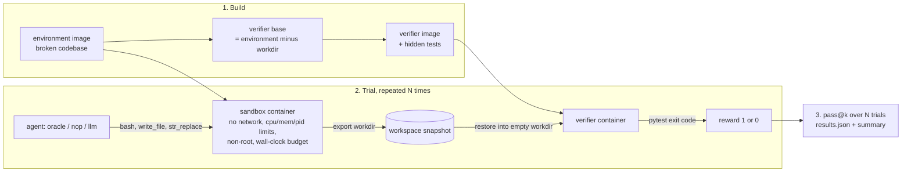

# Crucible

Crucible is a sandboxed evaluation harness for coding agents. You author a task as a
directory: a Docker image holding a codebase in a known broken state, an instruction, a
reference solution, and hidden tests. Crucible builds the image, runs an agent against the
instruction inside an isolated container, grades the resulting workspace with the hidden
tests in a separate container, repeats for N trials, and reports pass@k. It exists because
the trustworthiness of an agent benchmark rests on two boring properties that are easy to
get wrong: the agent must not be able to see or influence the grader, and the task itself
must be proven solvable and non-trivial. Crucible makes both properties mechanical.

## How it works



The core is hexagonal. `Runner` orchestrates build, trials and scoring and depends only on
three ports; concrete technology lives in adapters and is injected through the constructor,
so the runner is tested with in-memory fakes and no Docker.

| Port | Adapter | Responsibility |
| --- | --- | --- |
| `SandboxBackend` / `Sandbox` | `DockerSandboxBackend` / `DockerSandbox` | build images, start limited containers, exec, copy files, snapshot and restore a workdir, kill, teardown |
| `Agent` | `OracleAgent`, `NopAgent`, `LlmAgent` | act inside a sandbox to satisfy the instruction |
| `Verifier` | `PytestVerifier` | turn a workspace snapshot into a binary verdict |
| (pure) | `domain.scoring` | pass@k and summary statistics |

Three agents ship because they are how a harness earns trust:

- **oracle** applies the reference solution and must score 1.0 on every trial.
- **nop** changes nothing and must score 0.0 on every trial, proving the tests do not pass by default.
- **llm** drives a Claude model through a three-tool loop and is the thing you actually measure.

`crucible validate` runs oracle and nop and reports whether a task is **calibrated**. A task
that is not calibrated is not a task.

## Quickstart

Prerequisites: Docker (with BuildKit, the default on any current engine) and
[uv](https://docs.astral.sh/uv/). Python 3.11+ is managed by uv.

```sh
git clone https://github.com/chiillbro/crucible && cd crucible
uv sync

# Prove the example task is calibrated: oracle passes, nop fails.
uv run crucible validate tasks/fix-config-parser

# Run the oracle for three trials and report pass@1.
uv run crucible run tasks/fix-config-parser --agent oracle --trials 3 --k 1

# Run a real model. Needs an Anthropic API key.
cp .env.example .env            # then set ANTHROPIC_API_KEY
uv run crucible run tasks/fix-config-parser --agent llm --trials 5 --k 1
```

Each run writes `runs/<task>/<agent>/<timestamp>/results.json` plus per-trial verifier
output, and prints a summary:

```
task:   fix-config-parser  (/path/to/tasks/fix-config-parser)
agent:  oracle
trials: 3  passed: 3  pass@1: 1.000  pass@1: 1.000  mean reward: 1.000

  #  status         reward     time  reason
  0  passed              1     0.8s
  1  passed              1     0.7s
  2  passed              1     0.7s
```

Use `--log-level DEBUG` to see every command the agent runs and the full build logs.

## Anatomy of a task

```
tasks/fix-config-parser/
  task.toml                 name, difficulty, limits and timeouts
  instruction.md            what the agent is told, verbatim
  environment/
    Dockerfile              the broken codebase; must set a non-root USER
    workspace/...           files copied into the image
  solution/
    solve.sh                reference solution, run by the oracle in the workdir
    parser.py               whatever solve.sh needs
  tests/
    Dockerfile              FROM ${BASE_IMAGE}; COPY . /tests
    conftest.py             puts the workdir on sys.path
    test_hidden.py          the hidden tests
```

`task.toml` is validated by a strict Pydantic schema; unknown keys are errors.

```toml
[task]
name = "fix-config-parser"          # slug, used in image tags and result paths
description = "..."
difficulty = "medium"               # easy | medium | hard
tags = ["python", "parsing"]

[environment]
workdir = "/workspace"              # absolute; the directory that gets graded
build_timeout_seconds = 600

[agent]
timeout_seconds = 900               # hard wall-clock budget for the solve phase
cpus = 1.0
memory = "1g"                       # docker syntax: 512m, 2g, ...
pids_limit = 256

[verifier]
timeout_seconds = 120               # a hanging test run is a failed trial
```

`docs/authoring-a-task.md` walks through writing and calibrating a new task.

## Why the verdict can be trusted

- **The agent never sees the tests.** The agent's container is built from the environment
  image alone. Hidden tests exist only in the verifier image, which is built `FROM` a
  *verifier base*: the environment image with the workdir deleted.
- **The verifier sees only what the agent produced.** After the solve phase the workdir is
  exported as a tar archive and extracted into a fresh verifier container, whose workdir is
  checked to be empty first. The interpreter, installed packages and tests all come from the
  image; the snapshot is the single agent-controlled input.
- **The agent cannot reconfigure pytest.** pytest runs with `--rootdir` and `--confcutdir`
  pinned to `/tests`, so `conftest.py` or `pytest.ini` files left in the workspace are never
  loaded, and the workspace is deliberately not on `PYTHONPATH` so an agent-supplied
  `sitecustomize.py` cannot run at interpreter startup.
- **The sandbox is a sandbox.** `--network none`, CPU, memory and PID limits, all Linux
  capabilities dropped, `no-new-privileges`, a non-root user enforced by the harness, and a
  hard wall-clock budget after which the container is killed. Containers are always removed,
  even when a trial crashes.
- **Failures are recorded, never hidden.** A trial that times out, crashes, or hits a
  verifier error is written to `results.json` with reward 0 and a distinct status
  (`agent_timeout`, `agent_error`, `sandbox_error`, `verifier_error`) and a reason. Only
  `passed` earns reward 1.
- **Calibration is a command.** `crucible validate` fails with exit code 1 and a list of
  problems unless the oracle passes every trial and nop fails every trial.
- **Images are content-addressed.** Tags embed a digest of the build context, so
  `results.json` records exactly which bytes were evaluated.

pass@k uses the unbiased estimator from Chen et al. (2021), computed with exact rational
arithmetic. When it is undefined (no trials, or k larger than n) it is reported as `null`,
never approximated.

## Design decisions

Each choice is a short ADR in `docs/decisions/`:

- [0001](docs/decisions/0001-python.md) Python 3.11+
- [0002](docs/decisions/0002-docker-sdk-and-buildkit.md) Docker SDK for containers, BuildKit CLI for builds
- [0003](docs/decisions/0003-isolation-defaults.md) Isolation defaults: no network, limits, non-root, no capabilities
- [0004](docs/decisions/0004-toml-task-schema.md) TOML task files validated by Pydantic
- [0005](docs/decisions/0005-separate-verifier.md) Verification in a separate container from a clean base
- [0006](docs/decisions/0006-llm-agent-tool-loop.md) A minimal, explicit LLM tool loop; no silent model fallback
- [0007](docs/decisions/0007-settings-and-cli.md) pydantic-settings and Typer
- [0008](docs/decisions/0008-determinism-and-scoring.md) Determinism and the pass@k estimator
- [0009](docs/decisions/0009-content-addressed-images.md) Content-addressed images, kept by default
- [0010](docs/decisions/0010-hexagonal-core.md) Hexagonal core with Protocol ports

`docs/architecture.md` describes the modules, the trial state machine and the timeout model.

## Roadmap

Deliberately not built yet. The ports are shaped so each slots in as a new adapter or a new
caller of `Runner`, without changing the core.

- Parallel and asynchronous trial execution (a pool of `Runner` trials; the backend already
  isolates per container).
- Additional sandbox backends: Podman, remote executors (new `SandboxBackend` adapters).
- Multiple language runtimes and verifiers beyond pytest (new `Verifier` adapters; the
  snapshot/restore contract is language-agnostic).
- Network-allowed tasks with an explicit allowlist.
- Anti-cheat analysis of agent file access and command logs.
- A task-authoring wizard, a results database and a web dashboard.

## Development

```sh
uv sync
uv run ruff check . && uv run ruff format --check .
uv run mypy                              # strict, on src and tests
uv run pytest -m "not docker"            # fast unit tests, no Docker needed
uv run pytest -m docker                  # adapter and end-to-end tests against the daemon
uv run pytest --cov                      # coverage
```

CI runs lint, type checks and unit tests on Python 3.11 and 3.12, then the Docker suite
(which proves the example task is calibrated) on an Ubuntu runner.

## License

MIT. See `LICENSE`.
